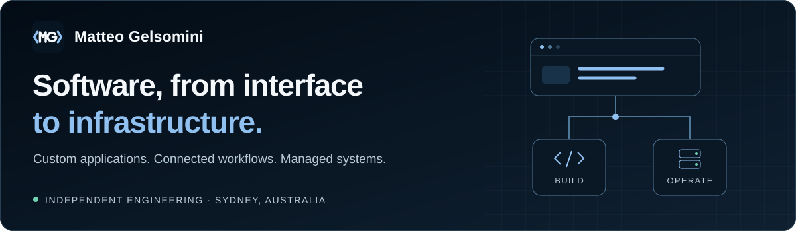

  

  <a href="https://matteogelsomini.com">Website</a> &nbsp;·&nbsp;
  <a href="https://matteogelsomini.com/services">Services</a> &nbsp;·&nbsp;
  <a href="https://matteogelsomini.com/work">Selected work</a> &nbsp;·&nbsp;
  <a href="https://matteogelsomini.com/contact">Discuss a project</a>

### Software that fits the way you work

Independent software engineering based in **Sydney, Australia**. I build custom applications,
connect business workflows and manage the infrastructure behind them.

| Software | Integrations | Infrastructure |
| :--- | :--- | :--- |
| Websites, customer portals, internal tools and commerce experiences. | APIs, connected systems and automation for everyday operations. | Managed hosting, monitoring, backups and ongoing maintenance. |

### From the first decision to the next release

- **Clear scope:** define the problem, responsibilities and acceptance criteria before building.
- **Practical delivery:** review working software in small steps, with checks before each release.
- **Ongoing ownership:** keep systems maintainable, documented and supported after launch.

Most client development happens in private repositories. Explore the [public case studies](https://matteogelsomini.com/work)
for examples of the work, or [get in touch](https://matteogelsomini.com/contact) to discuss your requirements.

---

Matteo Gelsomini · Custom software & managed infrastructure · Sydney, Australia
